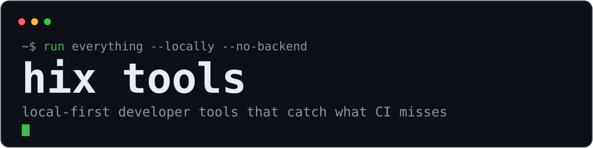

**Local-first developer tools that catch what CI misses.**

Small, focused tools that run on your machine or in your CI. No backend, no account, no telemetry — just a check, a JSON report, and an exit code.

**Try in the browser:** [ActionLens](https://hix-pro.github.io/action-lens/) · [ComposeMap](https://hix-pro.github.io/compose-map/)  
**Run locally:** [OpenCode Telegram](https://github.com/hix-pro/opencode-telegram) · [EnvAudit](https://github.com/hix-pro/env-audit) · [API Watch](https://github.com/hix-pro/api-watch)

## Start here

<table>
<tr>
<td width="50%" valign="top">
<a href="https://hix-pro.github.io/action-lens/"></a>
<br><br>
<strong><a href="https://hix-pro.github.io/action-lens/">ActionLens</a></strong><br>
GitHub Actions, explained. Paste a workflow and see the job graph, real matrix size, token permissions, risky triggers, and run footprint — before it reaches <code>main</code>.
</td>
<td width="50%" valign="top">
<a href="https://hix-pro.github.io/compose-map/"></a>
<br><br>
<strong><a href="https://hix-pro.github.io/compose-map/">ComposeMap</a></strong><br>
Docker Compose, explained. Drop in a compose file and get a service graph plus a plain-English review of ports, mounts, secrets, and startup order.
</td>
</tr>
</table>

### Your agent, from your phone

[**OpenCode Telegram**](https://github.com/hix-pro/opencode-telegram) bridges Telegram and a local [OpenCode](https://opencode.ai) server: streaming replies, permission approvals, session and model switching, macros, schedules, and a guarded filesystem view. The allow-list and command guard are documented up front.

```bash
git clone https://github.com/hix-pro/opencode-telegram.git
cd opencode-telegram && ./install.sh
```

## The suite

**Review the change before it merges**

| Tool | Catches |
| --- | --- |
| [ActionLens](https://hix-pro.github.io/action-lens/) | Risky workflow triggers, token permissions, matrix size, script injection |
| [ComposeMap](https://hix-pro.github.io/compose-map/) | Privileged containers, leaked secrets, host mounts, startup order |
| [TypeShift](https://github.com/hix-pro/typeshift) | The semver bump implied by a TypeScript declaration diff |

**Watch the contract**

| Tool | Catches |
| --- | --- |
| [API Watch](https://github.com/hix-pro/api-watch) | Removed endpoints, new required fields, response enum drift |
| [Migration Guard](https://github.com/hix-pro/migration-guard) | Destructive SQL, blocking DDL, breaking renames |
| [EnvAudit](https://github.com/hix-pro/env-audit) | Missing, undocumented, unused env vars, and committed secrets |

**Follow the signal**

| Tool | Does |
| --- | --- |
| [RepoRace](https://github.com/hix-pro/reporace) | Ranks repositories by star velocity, not total stars |
| [OpenCode Telegram](https://github.com/hix-pro/opencode-telegram) | Remote control for a local OpenCode agent |

## Why local-first

- **Your code stays put.** No upload, no account, no telemetry. Browser tools parse in the tab; CLIs write to a local file or SQLite.
- **Built for CI.** JSON output, documented exit codes, and GitHub Action wrappers for the Rust CLIs.
- **Limits are documented.** The tools say what they cannot prove instead of guessing — approximate schema composition, unproven type assignability, heuristic overload pairing.

## Status

All eight tools are MIT-licensed and released. The Rust CLIs ship prebuilt binaries for Linux, macOS, and Windows on their releases pages; ActionLens and ComposeMap are deployed from `main`.

## Contact

Open an issue on the relevant repository. For security reports, use that repository's **Security** tab — each project ships a `SECURITY.md` with a response timeline.
